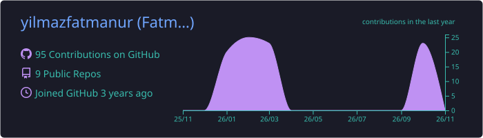
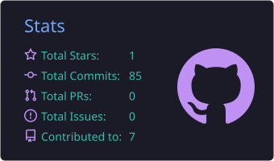
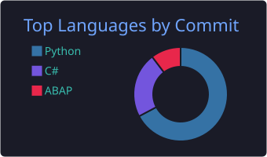
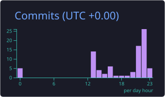

# Hi, I'm Fatmanur💫 
📌 Computer Programming graduate 📊 Data Analytics & SQL focused 🌱 Learning: SQL  • Database (PostgreSQL / MSSQL) 🚀 Building data projects & improving every day
 

# Tech Stack👩‍💻:

# GitHub Stats 📊 :

  

  
  

  

##  Socials 🌐:
 

